# StackSense

StackSense is a deterministic, rule-based technology stack recommendation engine. It validates the challenge schema, applies hard deployment/residency/compliance constraints before soft preferences, explains every recommendation, exports the prescribed JSON structure, and requires neither API keys nor an LLM.

[Project report (PDF)](output/pdf/StackSense_Report.pdf) · [Public scenario outputs](outputs/) · [Browser screenshots](report-evidence/)

## Try it in 60 seconds

1. [Download the project ZIP](https://github.com/shinjan-2006/StackSense/archive/refs/heads/main.zip), extract it, and open `index.html` in Chrome or Edge.
2. Under **Load a sample scenario**, choose **P2 · FixIt Now**. The recommendation appears immediately and the picker works offline.
3. Read the recommended stack, monthly estimate, and budget warning at the top. Expand **Budget-fit pilot** to see the smaller rollout, or open a component to see its rationale and alternatives.

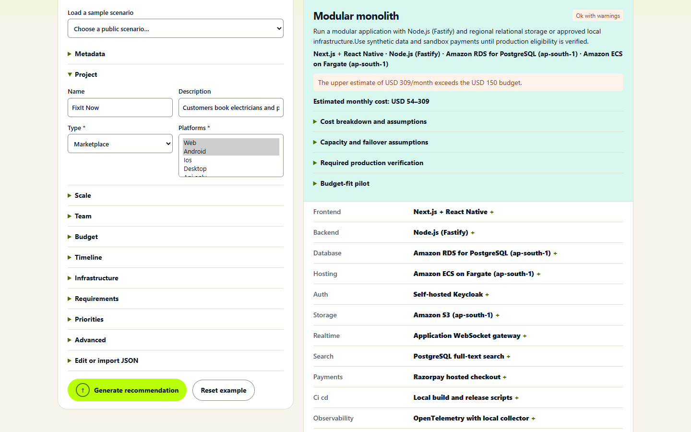

To see the recommendation respond to a change, edit the guided **Budget** field and click **Generate recommendation** again. Editing the budget clears the previous result.

## Technology and prerequisites

StackSense 1.0.0 uses plain JavaScript, HTML5 and CSS. The CLI and optional HTTP server require Node.js 18 or later and were tested on Node.js 24 on Windows. The browser app runs locally in Chrome or Edge. Use `npm.cmd` in Windows PowerShell if script execution policy blocks `npm`.

## Local setup and run

1. Download or clone the submission and open a terminal in the folder containing `package.json`.
2. For the CLI or server, install Node.js if needed and check it with `node --version`. The engine has zero package dependencies.
3. Open `index.html` directly for the offline browser app, or run the server command below.

For the browser app without a server, open `index.html` from the project folder in Chrome or Edge. Keep the adjacent JavaScript files in the same folder. Scenario import, recommendation generation, and JSON export run locally in the browser.

The optional HTTP server and CLI require Node.js 18+ (tested with Node 24). No package installation is required.

```sh
node server.js
# open http://localhost:3000

# CLI, one scenario (replace path with any standard-schema JSON object)
node cli.js --input my-scenario.json --out outputs/my-scenario_output.json

# all supplied public scenarios
npm run generate:public
npm test
```

The single-scenario command writes to the exact `--out` path and creates its parent directory when needed. If omitted, it writes `recommendation.json` in the working directory. The public scenario command reads the supplied JSON array and writes `outputs/P1_output.json` through `outputs/P6_output.json`. In the browser, upload or paste JSON, click **Generate recommendation**, then **Download output JSON**. The file goes to your browser's configured download location.

On Windows, you can instead double-click `start-stacksense.cmd`. Keep its terminal window open while using the local site; closing it stops the server.

## Architecture

```text
JSON / form -> shared schema -> constraint checks and provider / region selection
            -> backend scoring + capability rules -> cost gate -> JSON / results
```

- `engine.js`: knowledge-base rules, validation, warnings, cost bands, and output shaping.
- `schema.js`: field definitions shared by the engine validator and the browser form.
- `cli.js`: standard-file and batch execution.
- `server.js`, `index.html`, `app.js`: dependency-free local UI.
- `scenarios/`: supplied public scenario array. `outputs/`: six generated results.
- `test.js`: public scenarios and regression checks. `report-evidence/` and `output/pdf/`: browser screenshots and report.
- `capture-report.cjs` and `build-report.py`: optional evidence and PDF generation tools.

The engine never calls an LLM. The same input produces the same output. An explicit cloud choice takes precedence over ecosystem hints. Hosting, database and object storage are resolved together. An unresolved hard conflict or a modeled minimum above budget returns `infeasible` with no stack. An upper-band overrun produces a warning. Cost bands are planning allowances and exclude usage-dependent fees listed in the result. Compliance and external identity, SMS and payments require workload-specific verification.

`npm test` checks determinism, component cost totals, provider and storage consistency, air-gap isolation, platform coverage, budget failure and a priority sensitivity case. `capture-report.cjs` is an optional evidence tool that requires Playwright and Chrome. The app and its test suite do not require those dependencies.

## Input design and research

Use the grouped fields in the browser or expand **Edit or import JSON** to paste or upload a scenario. See [Input design and research](INPUT-RESEARCH.md) for validation rules, optional field effects, and technology sources.

## Evidence

These unedited Chrome captures show the results generated by the running StackSense engine. The [project report](output/pdf/StackSense_Report.pdf) explains the decisions, and the [public JSON outputs](outputs/) provide the full results.

### Public scenarios

**P1 · DevFolio**

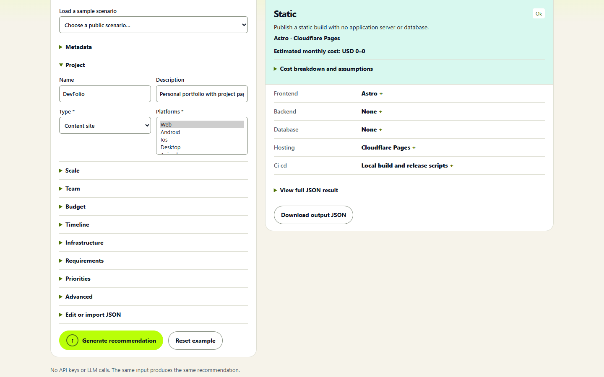

**P2 · FixIt Now**

[See the FixIt Now screenshot in the quick start](#try-it-in-60-seconds).

**P3 · BoardRoom**

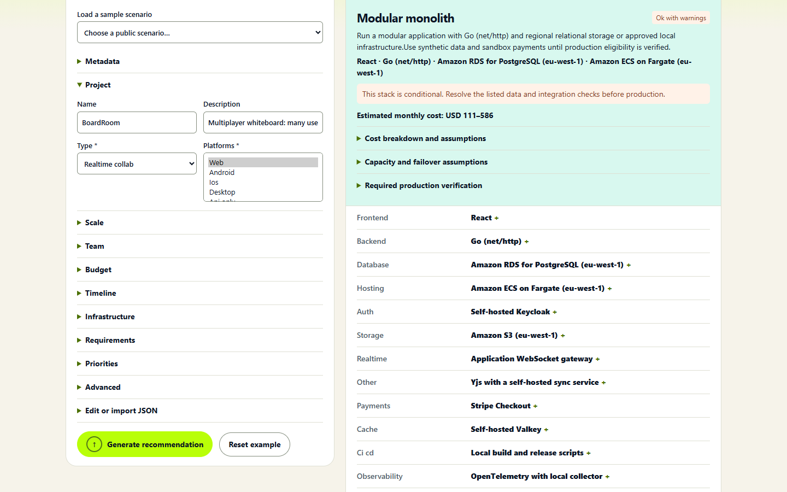

**P4 · QuickCredit**

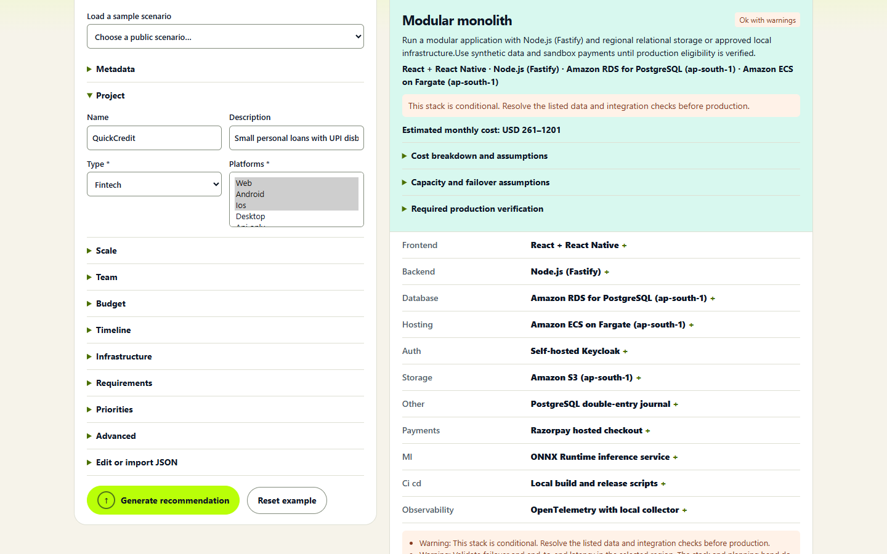

**P5 · PeopleDesk**

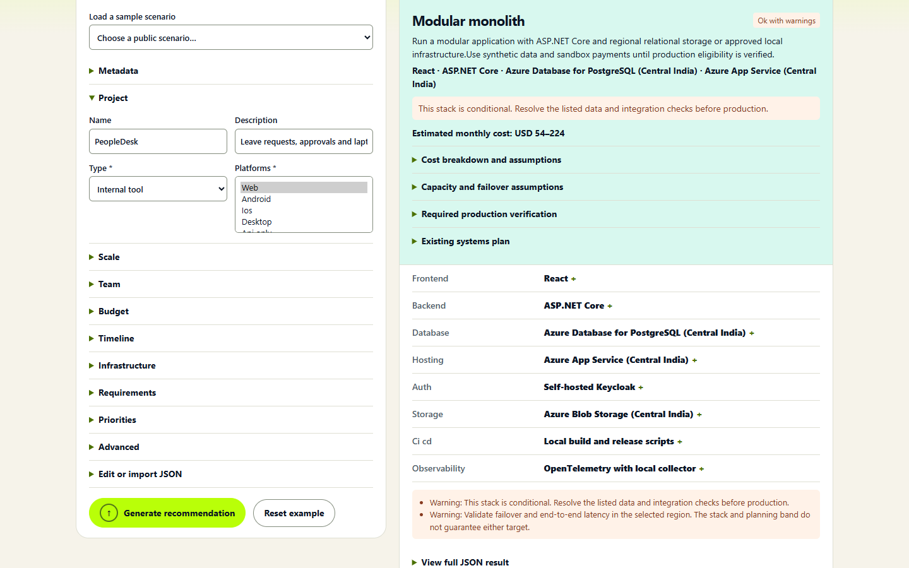

**P6 · KhetSurvey**

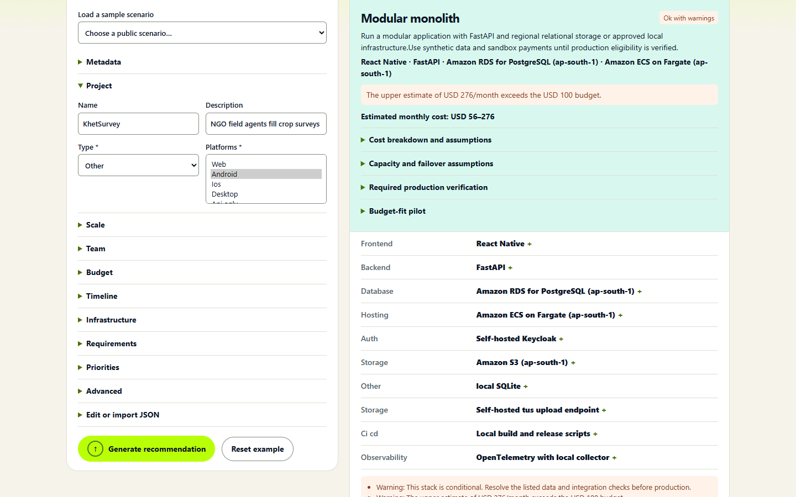

### Edge cases

**Missing required fields**

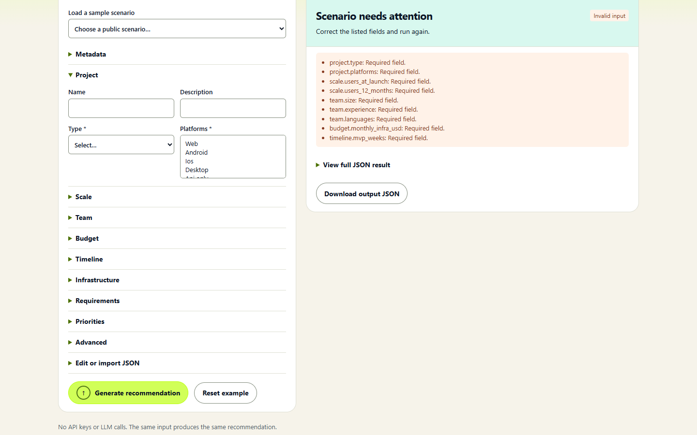

**Invalid input type**

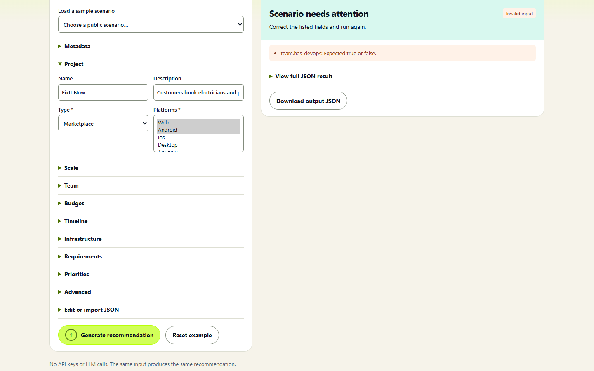

**Budget contradiction**

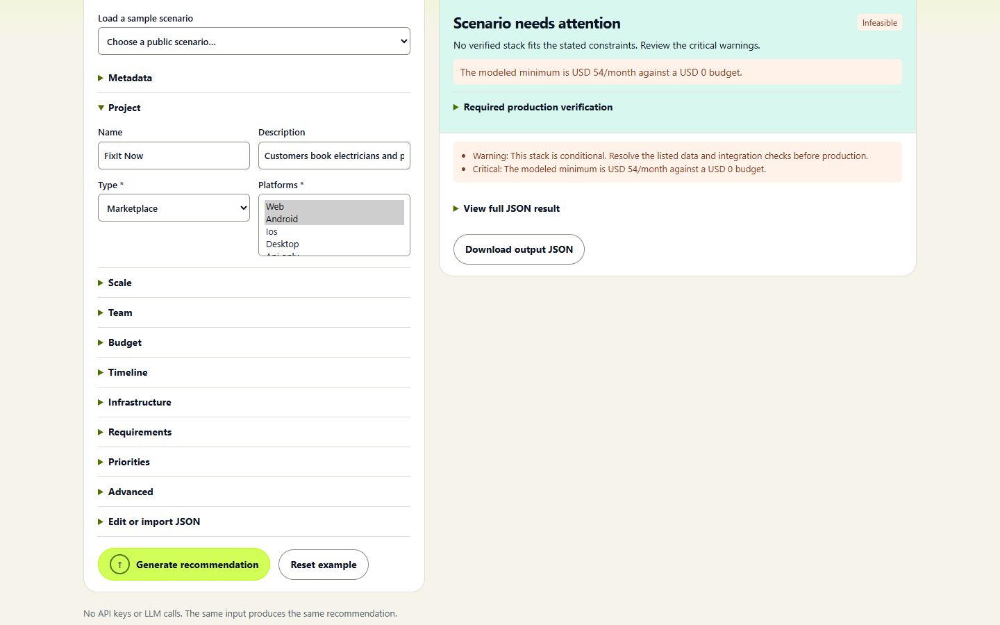

**High-traffic static site**

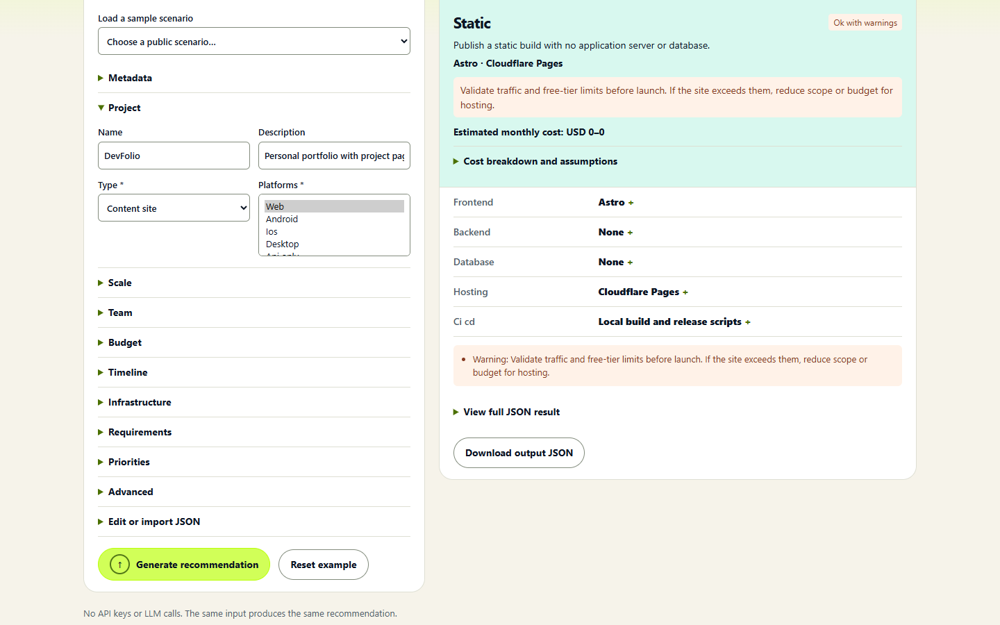

**Blocked unreviewed production**

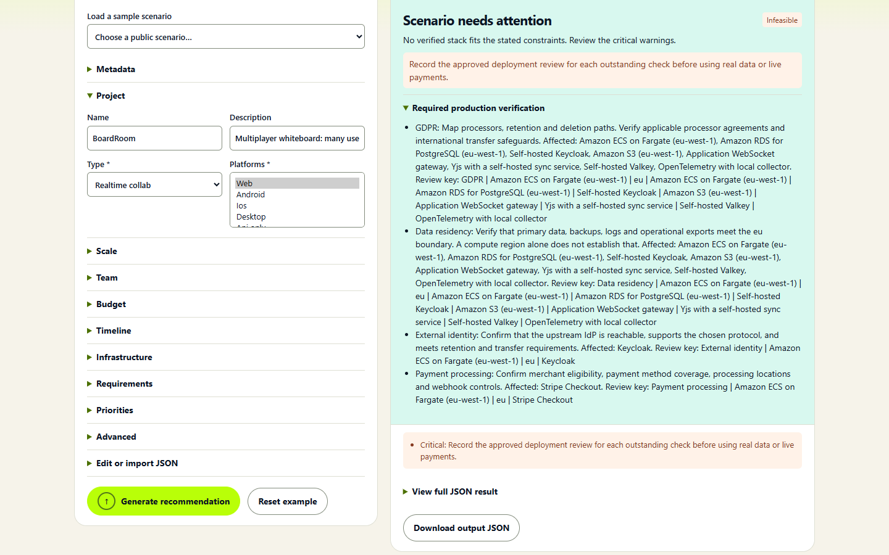

**Existing database integration**

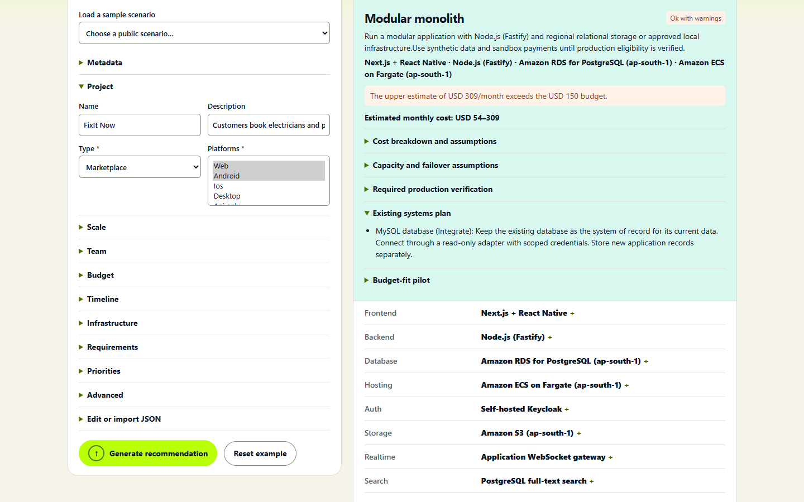

**Air-gapped deployment**

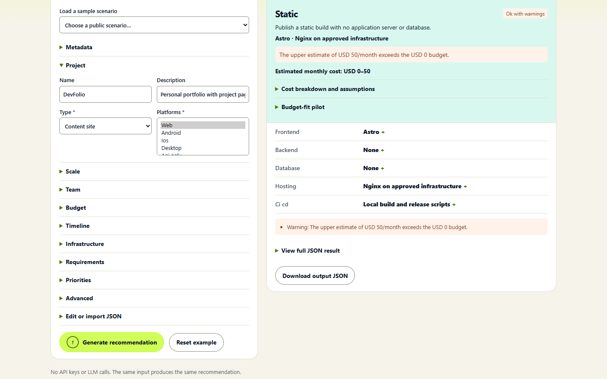

**Team skill mismatch**

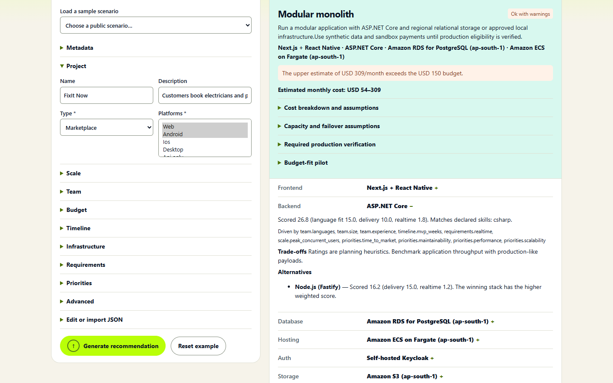

**Retired technology warning**

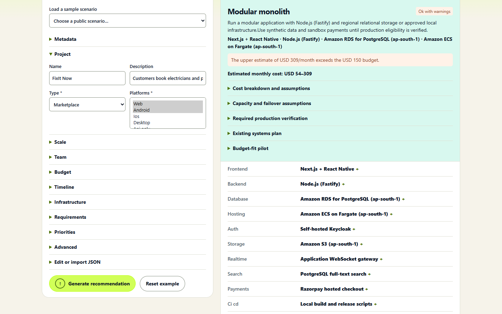


## LLM features

The runtime is entirely deterministic and makes zero LLM calls. All features run offline and there is no LLM switch to configure.

## Sources and credits

No third-party runtime libraries are used. Technology choices are based on official product documentation and pricing information: [Astro](https://docs.astro.build/), [AWS](https://aws.amazon.com/pricing/), [Azure](https://azure.microsoft.com/pricing/), [Cloudflare](https://www.cloudflare.com/developer-platform/products/pages/), [PostgreSQL](https://www.postgresql.org/docs/), [React](https://react.dev/), [Spring Boot](https://spring.io/projects/spring-boot/), and [OpenTelemetry](https://opentelemetry.io/docs/). See the problem statement for the required input/output schema.

The organizers supplied the problem statement and [six public scenarios](scenarios/stacksense_public_scenarios.json). The runtime uses built-in [Node.js](https://nodejs.org/) and [browser APIs](https://developer.mozilla.org/en-US/docs/Web/API) and calls zero third-party APIs. Optional report tooling uses [Python](https://www.python.org/), [ReportLab](https://www.reportlab.com/), [Playwright](https://playwright.dev/) and [Chrome](https://www.google.com/chrome/). OpenAI Codex assisted with implementation, tests and report preparation.
